# Architecture

## Three tiers, one division of responsibility

```
React (browser) --REST/JSON--> Python gateway --custom socket protocol--> C engine
                                (localhost:8077)                          (127.0.0.1:9090)
```

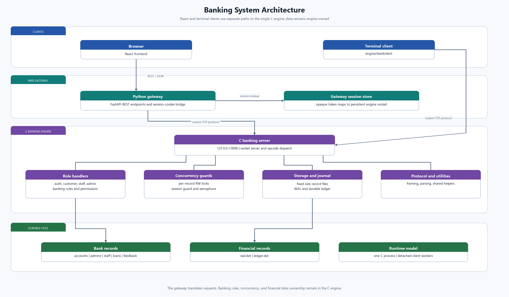

Open the architecture diagram separately: [architecture.png](./architecture.png).

<details>
<summary>Editable Mermaid source</summary>

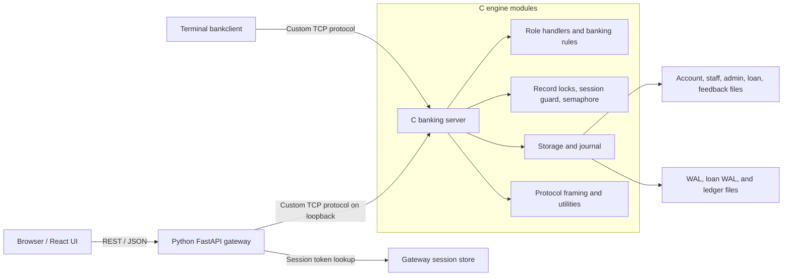

</details>

- **C engine** (`engine/`) owns everything the assignment is actually
  about: the account/admin data files, login, deposit/withdraw/balance/
  password/view, admin CRUD, concurrency, and locking. It's a standalone
  program -- `engine/bankclient` talks to it with zero Python/React
  involved.
- **Python gateway** (`gateway/`) contains no banking logic. Every
  endpoint does the same thing: look up the caller's engine connection
  from a session cookie, forward one request over the engine's wire
  protocol, translate the text response to JSON. See `docs/protocol.md`
  for that wire format.
- **React frontend** (`frontend/`) talks only to the gateway's REST API.

## Data files

Fixed-size binary records in `engine/data/accounts.dat` and
`admins.dat`, addressed directly by `account_id`/`admin_id` (`offset =
id * sizeof(record)`) -- no index, no database library. I/O uses
`pread()`/`pwrite()` (not `lseek()`+`read()`/`write()`) specifically
because the file descriptor is shared across all client threads;
positioned I/O keeps each access atomic without needing a separate lock
just to protect the fd's seek position.

A joint account is one record with two owner name/password-hash slots
(`owner1_*`, `owner2_*`) sharing one balance -- that's what makes two
joint holders' concurrent deposits/withdrawals contend on the same lock.

## Roles: Customer, Employee, Manager, Administrator

Four roles, three credential stores:

- **Customer** is the existing `Account` record (`engine/include/common.h`)
  -- a normal or joint account holder, unchanged by the role expansion.
- **Employee** and **Manager** records share `staff.dat`, but use
  separate ID ranges in the file: Employee IDs occupy slots `1..MAX_STAFF`
  and Manager IDs occupy `MAX_STAFF+1..2*MAX_STAFF`. Their IDs and login
  kinds are independent, so both can be ID 1 (`EMPLOYEE|1|...` and
  `MANAGER|1|...`). The record role is still checked server-side on every
  opcode (`is_employee()`/`is_manager()` in `server.c`), never trusted
  from the client. Older staff records are moved to the role-specific
  range when the engine starts.
- **Administrator** keeps the pre-existing `admins.dat`/`ADMIN` login
  kind, and has superset access over everything Employee/Manager can do
  (`is_admin()` short-circuits every permission check).

The diagrams below use UML class notation to make the C structs and
subsystems easier to discuss. They are conceptual: the records are
`typedef struct`s, and the subsystem “classes” are C modules/functions,
not object-oriented classes.

<details>
<summary>Editable Mermaid source</summary>

### Banking records

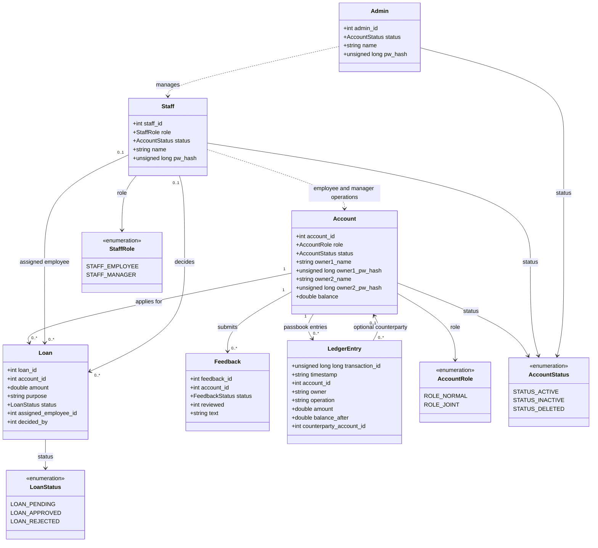

The relationships are represented by record IDs rather than pointers:
for example, `Loan.account_id` refers to an `Account`, while the two staff
IDs are zero when a loan has not yet been assigned or decided.

### Runtime and service modules

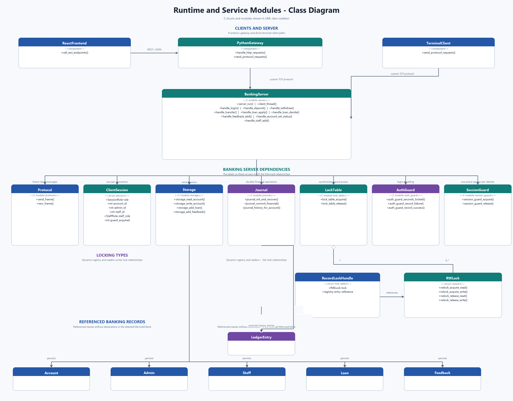

Open the PNG separately: [runtime-class-diagram.png](./runtime-class-diagram.png).

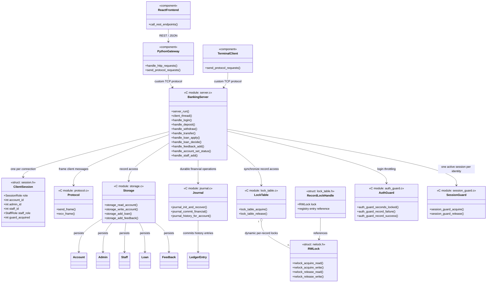

</details>

Permission matrix (also in `docs/protocol.md`): Customer operations are
always scoped to the caller's own account (there is no opcode that lets
a Customer name a different account, except `TRANSFER`'s destination and
the destination is never trusted with elevated rights on it); Employee
can manage customer accounts and decide loans assigned to them; Manager
activates/deactivates accounts, assigns loans, and reviews feedback. All
staff roles can inspect loan decision history. Administrator can perform
Employee and Manager operations as well as manage Employee/Manager
accounts themselves.

## Source layout and module boundaries

`engine/src/common/` contains reusable infrastructure: storage, protocol
framing, WAL/ledger recovery, locks, authentication guards, session guards,
role-access policy, and shared response formatting (`response_format.c`).
`engine/src/roles/auth/auth.c` owns login and password changes;
`roles/customer/customer.c` owns customer operations;
`roles/staff/employee.c` owns employee loan decisions, while
`roles/staff/manager.c` owns loan assignment, feedback review, account status,
staff-directory operations, and the unassigned pending-loan queue. A customer
loan application enters that queue first; only after a Manager assigns it can
the selected Employee view and decide it. Both modules reuse the shared access, storage, lock,
and response-format modules rather than duplicating those mechanisms.
Permitted read-only account views remain in the shared authorization path; and
`roles/admin/admin.c` owns customer lifecycle
and staff administration. `server.c` is limited to connection lifecycle,
frame dispatch, and logout cleanup. A client request runs in its own detached
thread, so an ordinary customer request error or disconnect is contained to
that connection and does not stop staff or administrator use.

Loan approval commits the approved loan record, the applicant's increased
balance, and a `LOAN_DISBURSEMENT` passbook entry in one WAL transaction.
Thus a successful approval is visible both in the loan decision history and
in the customer's normal transaction history; recovery redoes or undoes the
three updates together.

This is a modular single-process server, not separate role processes: a
process-level fault remains process-wide by definition.

## The custom readers-writer lock

The assignment's locking requirement (read lock for viewing a joint
account, write lock for deposit/withdraw) is deliberately **not**
implemented with `fcntl()`/`flock()` record locks or `pthread_rwlock_t` --
both of those are the OS's/libc's pre-built locking service, which would
defeat the point of implementing it. Instead `engine/src/rwlock.c` hand-
rolls the classic writer-priority readers/writers algorithm out of
`pthread_mutex_t` + `pthread_cond_t`. `engine/src/lock_table.c` keeps a
small hash-bucket registry and creates an `RWLock` only when a record is
accessed. Each borrower holds a reference before waiting for the lock, and
releases it only after releasing the reader/writer lock; the final release
unlinks and destroys the idle entry. The same registry provides per-record
locks for account, administrator, and staff records, so unrelated staff or
administrator updates can proceed concurrently. Loans use the same dynamic
per-record scheme. Ledger append slots are reserved under a short mutex;
financial commits share a ledger-visibility lease, while passbook/history
reads take it exclusively and therefore never return a PREPARED entry.

This was load-tested directly: 400 concurrent `+1` deposits fired at the
same joint account from two threads simultaneously landed on exactly the
expected final balance, with no lost updates.

## ACID funds transfer

`TRANSFER` (`handle_transfer()` in `engine/src/roles/customer/customer.c`) is the one
operation that touches two accounts at once, which is exactly the case
the single-account `RWLock` design didn't have to worry about -- and
exactly the case the spec's evaluation criteria call out by name
("Concurrency, synchronization, and ACID properties"). Each property,
concretely:

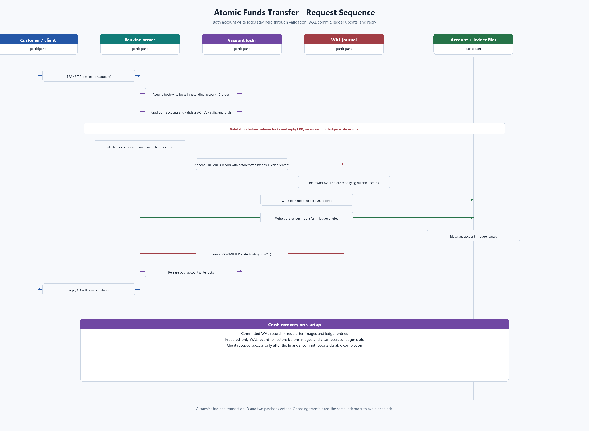

Open the transfer diagram separately: [transfer-sequence.png](./transfer-sequence.png).

<details>
<summary>Editable Mermaid source</summary>

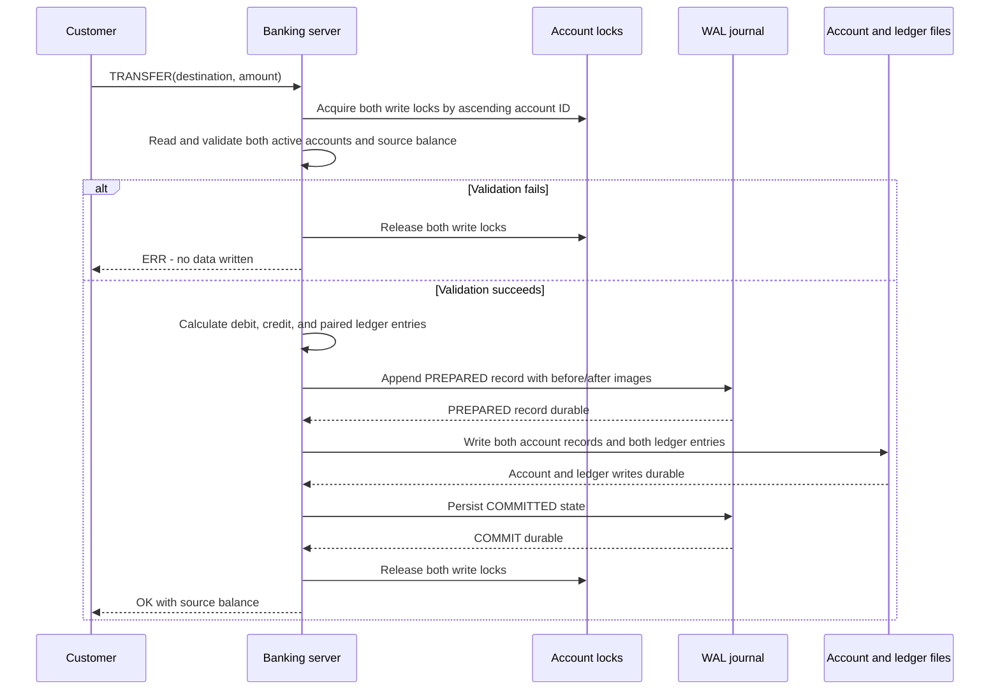

</details>

- **Atomicity.** Both accounts' write locks are acquired *before* either
  balance is read, and both writes happen inside that same locked
  section. If any validation fails (destination missing, insufficient
  funds, self-transfer), the function returns before writing anything --
  there is no state where only one side of a transfer has happened
  because a check failed partway through.
- **Isolation.** Because both locks are held for the *entire*
  validate-then-write critical section, no other operation on either
  account -- a deposit, a withdrawal, another transfer, even a plain
  balance read -- can be interleaved in the middle of a transfer. Every
  other operation either fully precedes or fully follows it.
- **Consistency.** The debit and credit are the same `amount` by
  construction, so the sum of the two balances is invariant across a
  transfer; the write only happens after both accounts are confirmed
  `ACTIVE` and the source has sufficient funds.
- **Durability.** `storage_write_account()` calls `fdatasync()` after
  every `pwrite()` (see `engine/src/storage.c`), so a committed leg of a
  transfer is flushed to disk, not just sitting in the page cache, by
  the time the function returns -- it survives a crash immediately after.

**Deadlock avoidance.** The obvious implementation -- lock the source,
then the destination -- deadlocks the moment two transfers run in
opposite directions at the same time: a transfer A→B locks A then waits
for B, while a concurrent transfer B→A locks B then waits for A, and
neither ever proceeds. The fix is a global lock ordering: `handle_transfer`
always acquires the *lower* account id's write lock first, regardless of
which account is the source:

```c
RWLock *first_lock  = (from_id < to_id) ? lock_from : lock_to;
RWLock *second_lock = (from_id < to_id) ? lock_to : lock_from;
rwlock_acquire_write(first_lock);
rwlock_acquire_write(second_lock);
```

Every transfer, regardless of direction, therefore agrees on which lock
to take first, so a circular wait can never form. This isn't just argued
from theory: `tests/test_engine.py` fires 150 transfers A→B concurrently
with 150 transfers B→A (300 total, two threads hammering the same two
accounts in opposite directions at once) and asserts both that neither
thread hangs and that the combined balance across both accounts is
exactly conserved afterward.

## Concurrency and durability

- **Multithreading**: the server's `accept()` loop spawns one
  `pthread_create()` worker per client connection (`engine/src/server.c`).
- **Write-ahead log (WAL)**: each financial worker writes a `PREPARED`
  record containing account before-images, after-images, and ledger entries,
  and syncs it before changing data files. It syncs a `COMMITTED` record only
  after account and ledger writes are durable. This does not make unrelated
  accounts serial: each request still owns only its affected account locks;
  the tiny WAL append/commit sections are serialised solely to preserve
  journal record order.

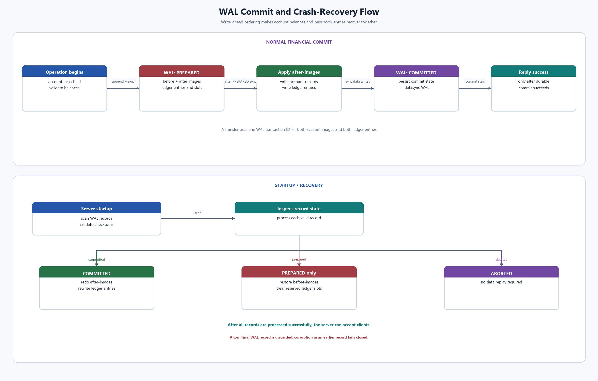

Open the WAL diagram separately: [wal-recovery.png](./wal-recovery.png).

<details>
<summary>Editable Mermaid source</summary>

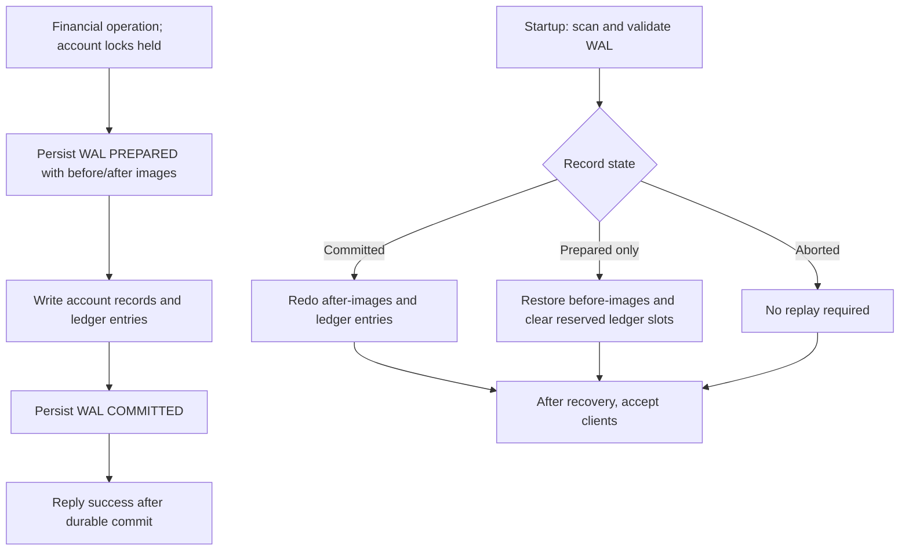

</details>

- **Semaphores**: a POSIX counting semaphore (`sem_init`/`sem_wait`/
  `sem_post`, `engine/src/server.c`) caps how many client connections are
  served at once (`MAX_CONNECTIONS`, 50). The `accept()` loop calls
  `sem_wait()` before every `accept()` and each client thread calls
  `sem_post()` on exit, so a connection flood queues in the kernel's
  `listen()` backlog instead of spawning an unbounded number of threads
  -- this was previously a named "future work" item in the security
  review below, closed once the spec asked for semaphores explicitly.
- **One session per user**: `engine/src/session_guard.c` is a small
  mutex-protected presence table (deliberately *not* the semaphore above
  -- this is uniqueness tracking, not a counting resource) keyed by
  `(role, id)` for Staff/Admin and `(account_id, owner_slot)` for
  Customers, so a joint account's two owners remain independently
  logged-in-able while the *same* owner logging in twice concurrently is
  refused. `LOGOUT` releases the slot before replying, giving callers a
  synchronous guarantee that the identity is free the moment they see
  `OK|bye`, rather than racing a socket-close-detection window.

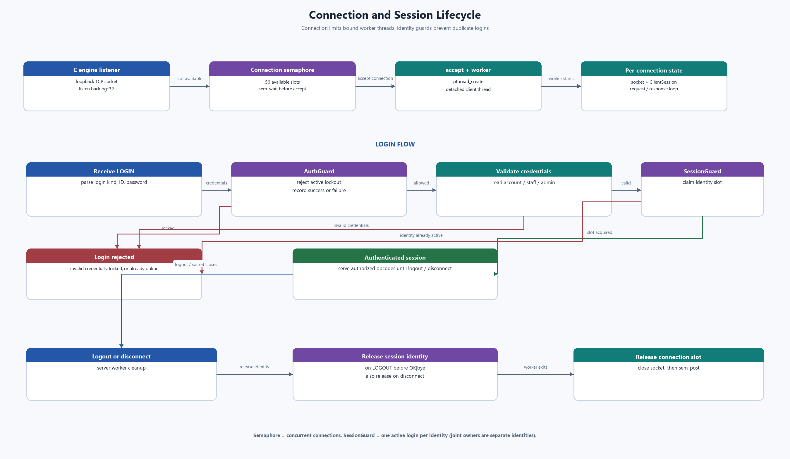

Open the session diagram separately: [connection-sessions.png](./connection-sessions.png).

<details>
<summary>Editable Mermaid source</summary>

```mermaid
flowchart LR
    Listener["C engine listener"] -->|sem_wait: slot available| Semaphore["Connection semaphore"]
    Semaphore -->|accept| Worker["Detached client worker"]
    Worker --> Session["Per-connection ClientSession"]
    Session --> Login["Receive LOGIN"]
    Login --> Auth["AuthGuard checks lockout and records result"]
    Auth --> Credentials["Validate credentials"]
    Credentials --> Guard["SessionGuard claims identity slot"]
    Guard -->|acquired| Active["Serve authorized requests"]
    Guard -->|already active| Rejected["Reject duplicate login"]
    Auth -->|locked| Rejected
    Credentials -->|invalid credentials| Rejected
    Active -->|LOGOUT or disconnect| ReleaseIdentity["Release identity slot"]
    ReleaseIdentity -->|worker exits| ReleaseConnection["Close socket; sem_post"]
```

</details>

## Transaction history uses the durable ledger

`ledger.dat` is one fixed-record, shared passbook ledger. Every ledger
entry contains its `account_id`; `TXN_HISTORY` scans it and filters by the
caller or staff-selected account ID, returning the latest 20 committed
entries. A transfer writes two entries with the same WAL transaction ID:
the source's debit and destination's credit.

New transaction timestamps use `Asia/Kolkata` by default when the engine
starts without a `TZ` environment variable. Set `TZ` before starting the
engine to select another timezone. Existing ledger timestamps are preserved
as originally recorded.

The financial WAL protects ledger records and account records together. On startup,
recovery redoes a transaction with a durable `COMMITTED` record and undoes
one left `PREPARED`, including clearing its reserved ledger entries. A client
never receives success until both the balance and passbook entry are durable.
Loan approvals use the separate `loan_wal.dat`, keeping the established
`wal.dat` record format compatible while atomically recording the loan status,
account credit, and passbook entry. Startup and periodic recovery apply the
same redo/undo rules to both logs.

`TXN_HISTORY` returns each transaction's *actual owner name* (not just
"owner1"/"owner2"), captured into the log line at the moment of the
transaction (`handle_deposit`/`handle_withdraw` in `server.c`, using
`sess->as_owner2` to pick `owner1_name` or `owner2_name`) -- this is what
lets a joint account's history show that a given withdrawal was `bob`'s,
not just "the account's".

## Session bridging in the gateway

On `/api/login`, the gateway opens a new TCP socket to the C engine,
performs `LOGIN`, and -- if it succeeds -- keeps that socket open for the
lifetime of the browser session. The React UI stores an opaque token in
tab-scoped `sessionStorage` and sends it in `X-Session-Token`; this keeps a
Customer tab and an Employee/Manager tab independent in the same browser.
Subsequent requests reuse their own engine connection, mirroring "client
connects once, gets a menu, issues several operations" rather than
re-authenticating on every call.

One real bug this surfaced during testing: the gateway's session cookie
must be scoped consistently to the hostname the frontend actually calls
it by. `localhost` and `127.0.0.1` are different sites to a browser, so
if the frontend called `127.0.0.1:8000` while being served from
`localhost:5174`, the `SameSite=Lax` cookie from login silently would not
be sent on the next request. `frontend/src/api.js` calls the gateway at
`http://localhost:8077` specifically for this reason.

A closed browser tab never calls `/api/logout`, which would otherwise
leak that engine connection (and its logged-in session) forever.
`gateway/app/session_store.py` runs a daemon thread (`start_reaper()`,
launched from `main.py`'s startup hook) that closes any session idle for
more than 15 minutes.

## Security review

Since this is a banking system, the engine was re-read specifically
looking for ways a client could corrupt data or bypass a check, not just
whether the happy path worked. Four real issues were found and fixed
(all covered by regression tests in `tests/test_engine.py`):

1. **NaN/Infinity injection.** `atof("nan")` returns NaN, and in C,
   `NaN <= 0` is always false -- so the original `if (amount <= 0) reject`
   guard on deposit/withdraw did not catch it, and the account's balance
   field would be overwritten with NaN and persisted to disk, permanently
   corrupting that account. Sending `"inf"` similarly set the balance to
   Infinity. Fixed by replacing `atof()` with `parse_amount()`
   (`engine/src/util.c`), a `strtod()`-based parser that explicitly
   rejects non-finite results and trailing garbage.
2. **Delimiter injection.** The wire protocol splits requests on `|`.
   `split_fields()` silently folds any *extra* `|` into the last field
   instead of erroring, so a value like an owner name containing `|`
   would shift every field after it into the wrong slot with no error
   returned -- e.g. a password ending up stored in what should have been
   a name field. Fixed by checking the exact `|` count of the raw payload
   against the opcode's expected field count *before* splitting
   (`count_char()` in `engine/src/server.c`), combined with an outright
   ban on `|`/`;` in any stored value (`has_reserved_char()`) so no field
   can legitimately need to contain the delimiter in the first place.
3. **No brute-force protection.** Login had no rate limiting at all --
   an attacker could guess passwords as fast as the network allowed, and
   account IDs are small sequential integers, making enumeration trivial.
   Fixed with `engine/src/auth_guard.c`: after 5 consecutive failed
   attempts against the same `(kind, id)`, further attempts are refused
   for 30 seconds *without checking the password*, which is what actually
   stops a guessing loop rather than just slowing it down.
4. **Unnecessary network exposure.** The engine listened on `0.0.0.0`
   (all interfaces) despite only ever being meant to talk to the gateway
   on the same host. Changed to bind `127.0.0.1` only.

**Known limitations, left as documented trade-offs rather than fixed**
(see the report for the reasoning): the engine's wire protocol has no
transport encryption (plaintext over loopback only, by design); password
hashing is a hand-rolled FNV-1a hash with no salt, chosen to avoid an
external crypto library rather than for real security; and there is no
CSRF token on the gateway's state-changing endpoints, though the
session cookie's `SameSite=Lax` setting already blocks cross-site
`fetch`/form submissions from attaching it, which covers the same threat
for this deployment shape.
